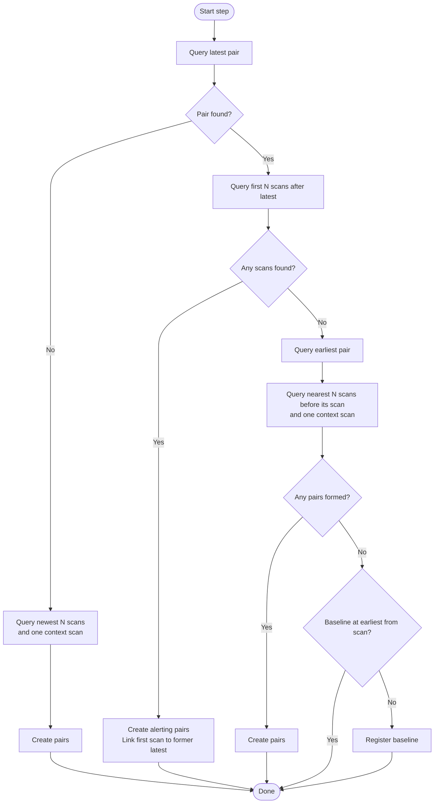
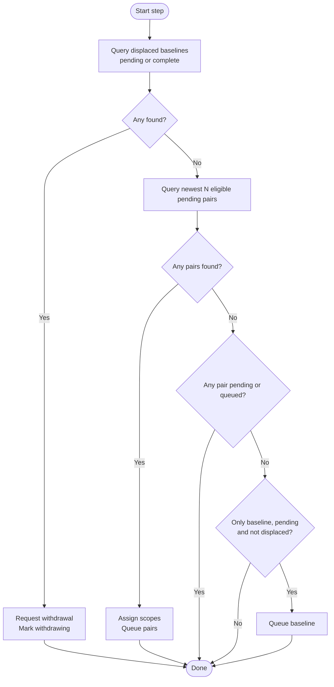

# Ingestion worker logic

Logical design implemented by `ingestion/decide.ts`, which both Convex workers apply.
`ingestion.md` covers execution and operations; the broader control-plane design is in `ingestion-control.md`.
Scheduling, execution machinery, and cycle sizes are outside this model.

## Inputs and ownership

| Worker          | Inputs                                                       | Durable output                                                     |
| --------------- | ------------------------------------------------------------ | ------------------------------------------------------------------ |
| Register worker | Target, registry edges and baselines, ordered source listing | Pairs and baselines registered as `pending`                        |
| Queue worker    | Registry records and their states                            | Requests accepted for execution; records `queued` or `withdrawing` |

The ingestion target is a required input. All source object query results are clipped to its range.
The charts assume this clipping and do not model it as a separate decision. It does not filter
already registered records from queue selection.

The register worker alone creates records. It does not inspect ingestion status. The queue worker
does not read the target, list source objects, or inspect execution machinery. Neither worker needs
to know whether the other is active, idle, interrupted, or scheduled to run again.

Each decision is a pure function of its inputs: register a batch of records, queue a batch, or do
nothing. Committing that decision changes the durable inputs for subsequent work. Reads need only
supply relevant boundaries and bounded candidates, not the entire registry.

Both workers are modeled as a single step: select at most one bounded batch, commit it, and finish.
Repeated invocation supplies the outer loop. Every invocation derives its next work afresh; no
worker cursor or remembered direction is required. The register worker reads the target at the
beginning of its step.

## Registry

Each registration is one record from `projections/model.md`, identified by `from_scan_at` and `scan_at`.

| Field           | Pair                                          | Baseline                   |
| --------------- | --------------------------------------------- | -------------------------- |
| `from_scan_at`  | The preceding source scan.                    | Null.                      |
| `scan_at`       | The scan the pair introduces.                 | The earliest input scan L. |
| `alerts`        | Set by the register worker for forward pairs. | Never set.                 |
| `current_scope` | Assigned by the queue worker when queued.     | Always complete.           |

- Pair order always means source time. Registering or executing pairs in reverse does not reverse their meaning.
- A record is positioned by its `scan_at`. No two pairs share one.
- A baseline is **displaced** when a pair has the same `scan_at`.

The pairs form one contiguous segment of the selected scan sequence. A missing hourly capture is not
a gap: adjacency follows available scans, not an assumed capture schedule. The earliest pair's
`from_scan_at` is introduced by no pair; it is the next backward candidate, or the baseline's scan.

| State         | Meaning                                                        |
| ------------- | -------------------------------------------------------------- |
| `pending`     | Registered or explicitly retried; awaiting selection.          |
| `queued`      | Its ingest request was durably accepted for execution.         |
| `complete`    | Its contribution is committed.                                 |
| `failed`      | Execution failed; it waits for an explicit retry to `pending`. |
| `withdrawing` | Its withdrawal request was durably accepted for execution.     |

A successful withdrawal deletes the record.

## Register worker

One step selects one batch, in priority order:

1. The newest scans for an empty registry.
2. The next scans after the latest pair.
3. The preceding scans before the earliest pair.
4. A baseline at the earliest pair's `from_scan_at`, when no earlier scan remains and none is registered there.

After committing that batch, the step is done; it does not fill an undersized batch with lower-priority work.

N bounds the number of new pairs. Bootstrap selects the newest N available scans. Forward selection
takes the first N scans after the latest `scan_at`. Backward selection takes the nearest N scans
before the earliest `scan_at`. These are counts of available scans, not durations or expected hourly slots.

### Create pairs

Adjacent scans within the selected batch form pairs. The earliest selected scan also needs its
immediate predecessor. For a forward batch, that predecessor is the former latest `scan_at`.
For bootstrap and backward batches, read one additional preceding scan as context. Fetching up to
N + 1 objects can therefore supply up to N new pairs. The context scan is not introduced by that batch.

A selected scan without a predecessor forms no pair. Bootstrap therefore needs at least two available
scans; a target holding one scan registers nothing.

Register bootstrap and backward pairs from newest to oldest, and forward pairs from oldest to newest.
This preserves a contiguous chain after every committed prefix. Register every new record as pending.
An empty selection creates nothing.

Only forward pairs alert: they describe changes detected after ingestion was already running.
Bootstrap pairs, backward pairs, and baselines describe history and never alert.

Each committed batch starts the registry, extends an existing edge, or places a baseline. Overlapping
attempts cannot create two starting batches or extend an obsolete edge; a decision overtaken by another
registration is recomputed from the resulting registry.

### Register a baseline

The baseline step runs only when the backward query forms no pairs: the earliest pair's `from_scan_at`
is the first scan in the target. Registering the baseline needs only the registry and the source listing.

- Backward batches register no baseline, so a baseline is created once per reach of the target start.
- When the target later moves back, backward batches register pairs behind the old baseline's scan.
- The first of those pairs displaces the old baseline; the queue worker resolves the collision.
- On reaching the new start, this step registers a baseline at the new earliest scan.

No work now means no available forward extension, no earlier scans left to register, and a baseline at
the earliest scan. It does not mean that a pair must equal the literal target end, or that future
source scans cannot create work. Source-listing failure interrupts the step; it is not evidence that
the source is empty.

## Queue worker

One step takes the first selection that finds work, commits it, and finishes:

1. Displaced baselines that are `pending` or `complete`: request their withdrawal.
2. Up to N eligible pending pairs, newest first, each with its assigned current scope.
3. The only baseline, if pending and not displaced, once no pair is pending or queued.

Selections 2 and 3 also respect a soft capacity on accepted records that are queued or withdrawing.
It reads stale aggregate counts so completions never conflict with the step; it can briefly overshoot. Pending records stay pending until completions free capacity, so
retries and withdrawals never wait behind a whole backfill in the execution backlog. Withdrawals
bypass the capacity.

A pending pair is ineligible while a baseline holds its `scan_at` or a queued full pair has a later
`scan_at`. An empty registry or selection produces no work. An undersized batch is not filled from a
later selection.

Newest-first selection gives forward work priority without a separate forward query.

### Current scope

The rules for each scope are in `projections/current-entities.md`. The queue worker assigns them from
registry state alone:

| Selected pair                                            | Scope      |
| -------------------------------------------------------- | ---------- |
| A complete full pair has a later `scan_at`.              | Departures |
| No full pair is queued or complete; newest in the batch. | Full       |
| Otherwise.                                               | Changes    |

- The first queued batch is normally one full pair; the pairs behind it wait until it completes.
- Backfill then commits departures only; forward pairs commit changes.
- A failed full pair stops counting, so the next selection assigns a new full pair.
- A retried pair receives a fresh scope when queued again.
- Withdrawing a full pair leaves earlier departures-only output in place; restoration covers the gap.

Current stats: read the latest registered pair and request its snapshot if it is in the selection.
Newer snapshot times win at persistence, including when the newer snapshot has no usable readings.

### Moving a baseline

A baseline and a pair sharing a `scan_at` would both claim that scan's output. That collision is the
only dependency between records, so it is resolved by registry state alone:

| Displaced baseline | Queue worker action                                              |
| ------------------ | ---------------------------------------------------------------- |
| `pending`          | Request withdrawal; it removes nothing if nothing was committed. |
| `queued`           | Wait for its execution to finish.                                |
| `complete`         | Request withdrawal.                                              |
| `failed`           | Wait for an explicit retry, then request withdrawal.             |
| `withdrawing`      | Wait for the withdrawal to delete the record.                    |

- The colliding pair stays ineligible until the record is gone.
- Only the queue worker installs a baseline, and only when no other exists, so at most one is installed.
- Pairs at other scans proceed meanwhile; their output is dated at their own scans.
- A failed withdrawal moves the baseline to `failed`.
- The new baseline waits for pairs to settle; installed earlier, unfinished pairs would extend its values too far.
- The baseline's current candidates are complete but lose to every newer retained row.

While no baseline is installed, history reads return nothing for unchanged entities. Charts render
what they can; later commits complete them.

### Queue records

Submit the selected records for execution and mark them queued. An empty selection does nothing.
This operation does not wait for ingestion to finish or select another batch.

Each request names its record, source scans, current scope, current-stats snapshot, and alert flag.
The per-table projection documents specify each process's work. Instructions already handed to
execution stay with that request.

`Queued` means the request was durably accepted for execution. Acceptance and the state change are
one logical operation. An overlapping queue attempt cannot admit the same pending record twice.
An interruption leaves either pending work to select again or an accepted request whose execution
is somebody else's responsibility.

A lost completion is backstopped by reconciliation: an accepted record whose request has finished
without settling it becomes `failed`, so it stops consuming capacity and blocking pairs, and awaits an explicit retry.

The queue worker ignores queued, failed, and complete pairs. A failed record becomes eligible only
when an explicit retry changes it to pending.

## Execution

The queue worker derives each request from durable registration state, never from which projection
rows happen to exist or from completion order.

Retry is an execution concern rather than another projection mode. Successful process output stays
committed, including an intentionally empty result. Per-process receipts keyed by scan record that
completion across retries; withdrawal releases them.

## Repair

Lost completions are repaired automatically by failing the record; retry stays explicit. Other repair is manual. With automatic invocation stopped and no queued work, an operator withdraws the
affected record and registers it again. The workers then resume from the resulting registry.

- Edge-only registration never re-adds an interior pair; the operator does.
- A re-added pair is ordinary pending work and receives a scope like any other.

## Resumption and progress

- An empty source range registers nothing; an empty registry queues nothing.
- With one registered pair, queue it if pending; otherwise the queue worker has no work.
- New pairs on either side become candidates without resetting progress.
- A manually retried record is found through pending state, even among thousands of completed pairs.
- Reducing the target never excludes registered pending work from the queue worker.
- A registry with only queued, failed, or complete records has no queue work; ingestion can still be unfinished.

Changing the batch allowance changes how much work is committed at once, without changing
eventual coverage for unchanged inputs. Each committed batch or admission removes its
own immediate registration or queueing need. Resuming repeats selection against the resulting state
rather than trusting where an earlier invocation stopped.

Forward-first priority is a preference, not a correctness dependency. Backfill progresses when
forward work leaves capacity. A sustained forward backlog can postpone it; guaranteed capacity
for both directions would be a separate scheduling policy. Selection priority neither reorders
already accepted requests nor promises their completion order.

Current writes accept a candidate only when it is newer than the retained row. This makes eventual
results independent of execution order, provided every required projection eventually succeeds.
Reverse queueing reduces redundant writes but does not require reverse completion.

## Edge-only registration

The register worker extends the registry only at its edges and never creates or searches for gaps.
Collection never introduces a scan inside an existing range, so reading the two registry edges is
sufficient. The projection model permits gaps, but this worker never produces them.
