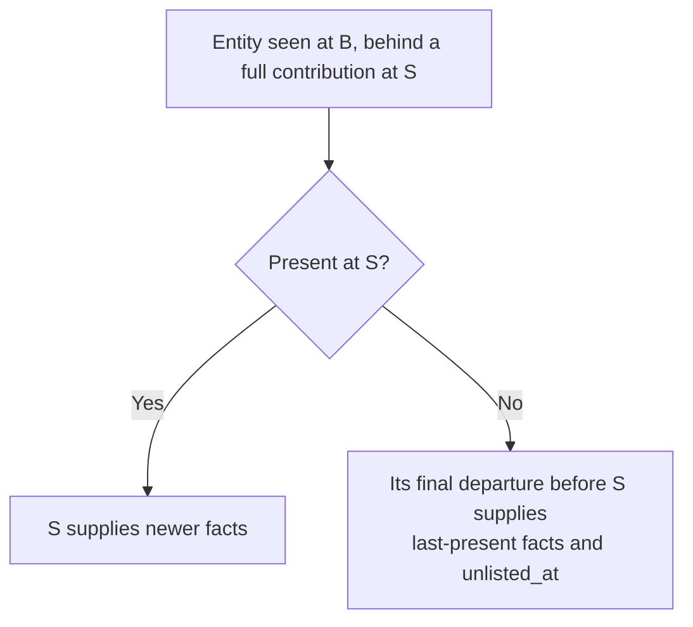
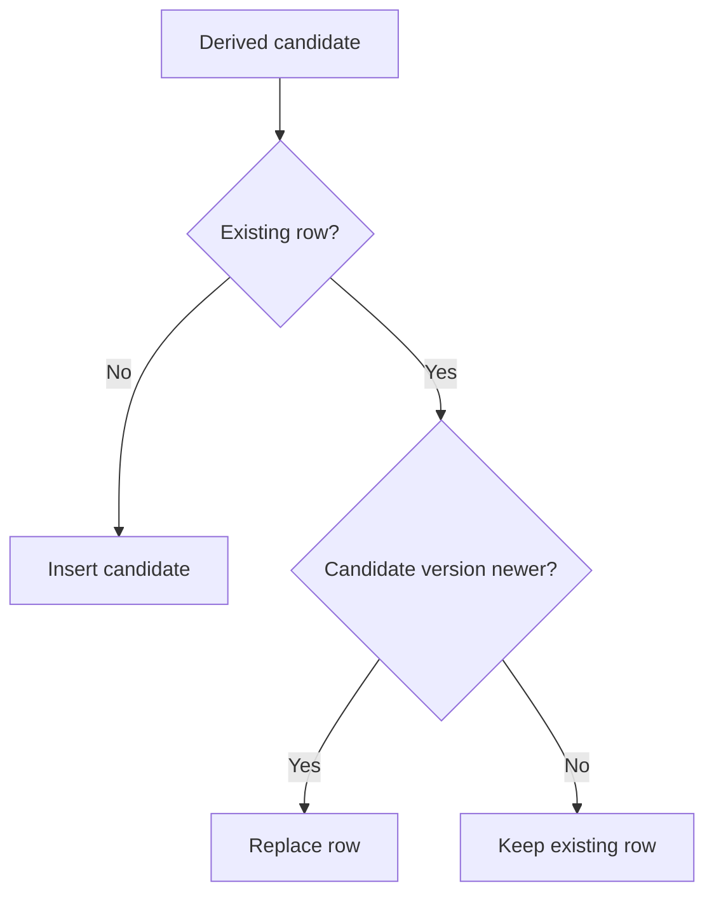
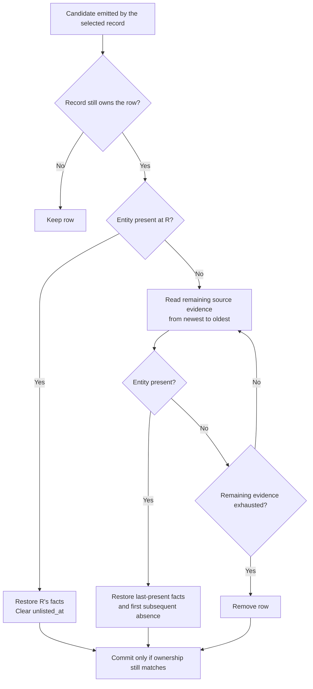

# Current entities

Proposed semantics using the shared operations and notation in `model.md`.

## Meaning

**Question answered:** What are the latest selected facts for each identity seen in the retained window?

| Entity in `[L, R]`           | Retained state                                                                  |
| ---------------------------- | ------------------------------------------------------------------------------- |
| Present at R                 | R's selected facts; listed.                                                     |
| Absent at R, present earlier | Last-present facts; `unlisted_at` is the first absent scan after that presence. |
| Never present                | No row.                                                                         |

| Table     | Presence means                        | Selected facts                                           |
| --------- | ------------------------------------- | -------------------------------------------------------- |
| Models    | Referenced by a listed endpoint.      | Model identity and selected metadata.                    |
| Providers | Referenced by a listed endpoint.      | Provider identity and selected metadata.                 |
| Endpoints | In the extracted endpoint collection. | Endpoint identity, relationships, and selected metadata. |

- All three use `unlisted_at`; reappearance clears it.
- A model or provider is present while it has listed endpoints and departs with its last one.
- Changes outside a table's selected fields do not require a current write.

## Derive

| Record        | Scope      | Output                                                               |
| ------------- | ---------- | -------------------------------------------------------------------- |
| Pair A → B    | Full       | Every entity present at B, and departures: A's facts, unlisted at B. |
| Pair A → B    | Changes    | Arrivals, reappearances, departures, and selected-fact changes.      |
| Pair A → B    | Departures | Departures only: A's facts, unlisted at B.                           |
| Baseline at L | Always     | Every entity present at L.                                           |

- Changes emit nothing for unchanged entities.
- Every scope emits departures, so an unlisted entity's last-present facts never depend on scope.

### When each scope suffices

| Scope      | Sufficient when                                                    | Cost                    |
| ---------- | ------------------------------------------------------------------ | ----------------------- |
| Full       | Always.                                                            | Every present entity.   |
| Changes    | Always; a baseline eventually supplies entities that never change. | Every changed entity.   |
| Departures | A full contribution with a later scan is already committed.        | Departed entities only. |

Arrivals and fact changes at B are therefore superseded before or at S. The final departure may belong
to a pair not yet committed; until it lands, the entity can show older facts.

Correctness never depends on a full contribution: changes and a baseline complete the view. A full
contribution makes the view complete for its scan immediately and lets older pairs commit departures only.

## Commit

Look up only emitted identities. Keep the candidate with the newer version.

| Candidate owner | Version |
| --------------- | ------- |
| Pair A → B      | `t_B`.  |
| Baseline at L   | `t_L`.  |

- Repeating the same owner, inputs, and rules produces the same candidate.
- A later unchanged pair emits nothing; the earlier change supplies the current candidate.

### What `scan_at` means

| It identifies                     | It does not identify                               |
| --------------------------------- | -------------------------------------------------- |
| The winning candidate's version.  | First appearance or last time the entity was seen. |
| The time used for write ordering. | Every scan at which those facts remain valid.      |

An old row can still be valid now. Restoration can choose another supported time within the range
where that representation is valid; it need not recover the exact timestamp of the overwritten row.
The chosen version still governs write ordering. Ownership identifies the contribution being retained.

## Read

| Request             | Result                                                                    |
| ------------------- | ------------------------------------------------------------------------- |
| Current identity    | Latest retained facts and listing state.                                  |
| Identity missing    | No retained row.                                                          |
| Historical snapshot | Use historical projections for their fields, or raw scans for full facts. |

- Retained rows can reflect different source times.
- Filtering current rows by `scan_at` cannot recover overwritten historical facts.
- A product-selected horizon cannot undo newer writes to produce an older snapshot.

## Withdraw

| Record        | Affected candidates                 | Preserve                     |
| ------------- | ----------------------------------- | ---------------------------- |
| Pair A → B    | Its scoped candidates, versioned B. | Rows owned by other records. |
| Baseline at L | Entities present at L, versioned L. | Rows owned by other records. |

For each affected winner, restore from supplied evidence associated with the remaining records.
When a moved baseline's scan remains another record's input, that scan still supports its candidates.
R below is the latest source time represented by those records and their inputs.

⚠️ The record's inputs, even with an adjacent third scan, cannot always supply a complete replacement.
An absent entity may have an earlier listing period whose facts have been overwritten.

Restoration may install an older version. It bypasses the ordinary newer-only merge.
Deletion requires exhausting the remaining evidence without finding the entity.

### Replacement evidence

| Remaining evidence for the affected identity                           | Restore                                                            |
| ---------------------------------------------------------------------- | ------------------------------------------------------------------ |
| An earlier source supports its last presence and subsequent departure. | Last-present facts and the supported `unlisted_at`.                |
| A later source still supplies the withdrawn winner's selected facts.   | Those later facts, even if the later comparison emitted no change. |
| Its only presence evidence belonged to the withdrawn record.           | Remove the row.                                                    |

| Scan    | Source state             | Current state after its pair |
| ------- | ------------------------ | ---------------------------- |
| A, full | Present with value `v1`. | `v1`, listed.                |
| B       | Absent.                  | `v1`, unlisted at B.         |
| C       | Present with value `v2`. | `v2`, listed.                |

Withdrawing C restores `v1`, unlisted at B. B alone cannot supply `v1`; restoration needs A.
Only affected identities need restoration. Finding their last presence can require searching all
remaining source evidence, back to the left horizon.

### Optimization: check neighbouring scans first

These shortcuts reduce source reads while preserving the restoration rule.

| Evidence already available                                                                              | Work saved                                                 |
| ------------------------------------------------------------------------------------------------------- | ---------------------------------------------------------- |
| A remaining later scan supports the valid replacement.                                                  | Restore from it without searching backward.                |
| The immediately preceding remaining scan supplies the last presence, with its subsequent absence known. | Restore the unlisted value without searching further back. |
| Neither neighbour contains the entity.                                                                  | No conclusion; continue the backward search.               |

A triple is a useful first check, not a guarantee of complete restoration.
