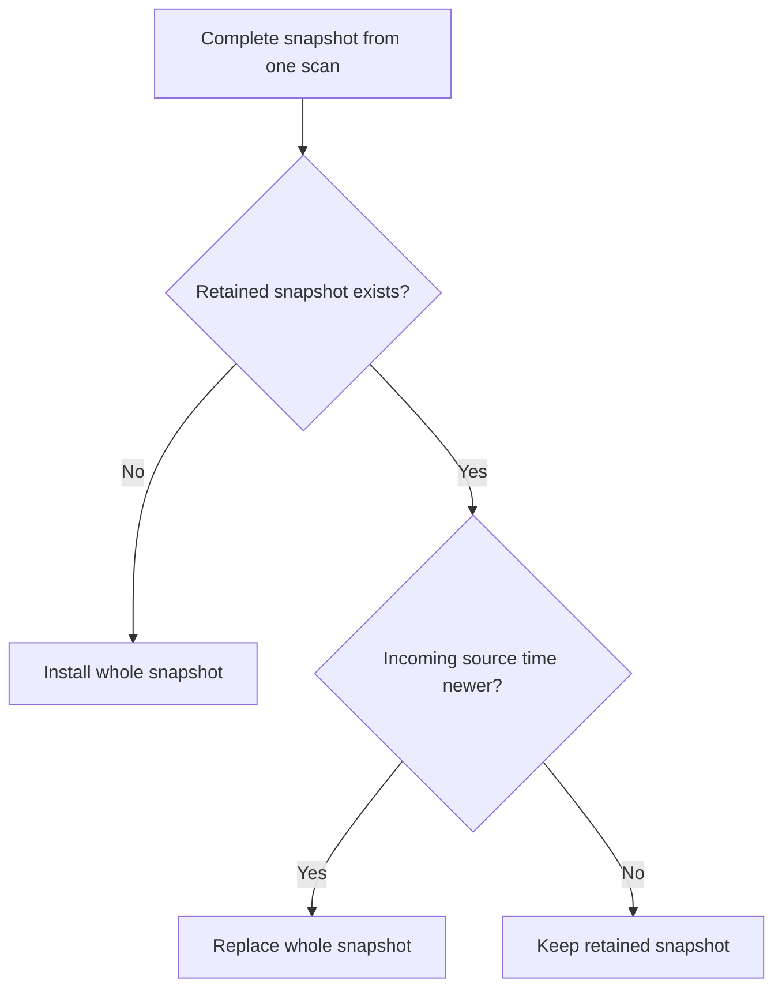
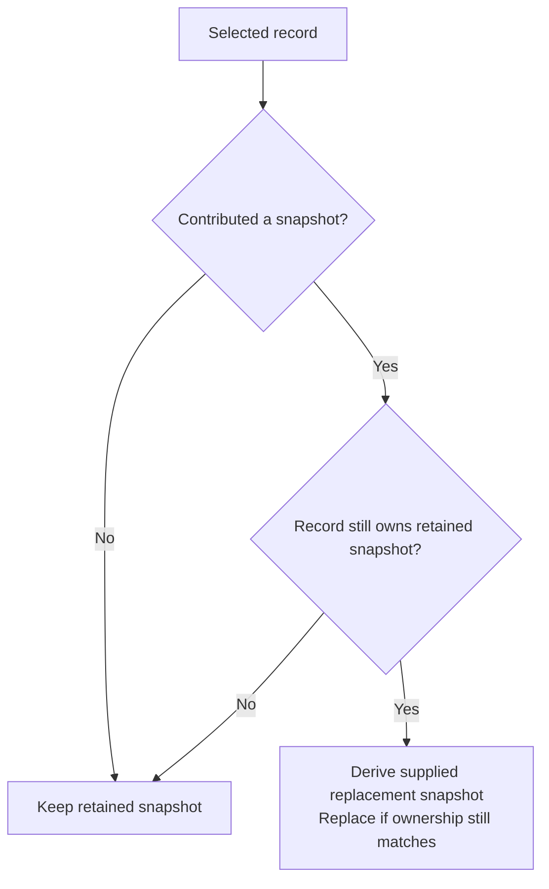

# Current stats

Proposed semantics using the shared operations and notation in `model.md`.

## Meaning

**Question answered:** What usable default-tier stats are in the latest retained snapshot?

| Snapshot                    | Meaning                                     |
| --------------------------- | ------------------------------------------- |
| Rows with an as-of time     | Complete selected stats from that one scan. |
| No rows, with an as-of time | Known empty snapshot.                       |
| No retained snapshot        | Unknown.                                    |

- Include usable default-tier readings; exclude missing, negative, and nonfinite readings.
- Every member comes from the same scan.
- A missing endpoint or metric does not preserve its older reading.

## Derive

| Operation  | Input           | Output                                 |
| ---------- | --------------- | -------------------------------------- |
| Pair A → B | Snapshot scope. | B's complete snapshot, possibly empty. |
| Pair A → B | No scope.       | No current-stats contribution.         |
| Baseline   | Scan L.         | No current-stats contribution.         |

### Optimization: derive only the latest snapshot

Only the latest snapshot survives commit. Older snapshots can be skipped while a newer one remains owed.

## Commit

### Empty means replace

| Derived result    | Commit                                                |
| ----------------- | ----------------------------------------------------- |
| Nonempty snapshot | Replace all earlier members.                          |
| Empty snapshot    | Clear all earlier members; retain the new as-of time. |

An empty result is still complete. It does not mean “keep the old stats.”

## Read

Return the retained snapshot and its as-of time.

| Earlier snapshot  | Later snapshot  | Read after later commit      |
| ----------------- | --------------- | ---------------------------- |
| Endpoints X and Y | Endpoint X only | X only, with the later time. |
| Endpoints X and Y | Empty           | Empty, with the later time.  |

Current stats does not combine members from different scans.
The retained snapshot keeps its as-of time until replaced.

## Withdraw

| Record             | Remove or restore                                                | Preserve                                  |
| ------------------ | ---------------------------------------------------------------- | ----------------------------------------- |
| Without a snapshot | Nothing; the record contributes no current stats.                | The retained snapshot and its as-of time. |
| With a snapshot    | Restore a supplied replacement if this record owns the snapshot. | A snapshot owned by another record.       |

Replacement inputs identify a remaining pair and supply its scan.
That record owns the restored snapshot.

An empty replacement clears the rows and retains its source's as-of time. Restoration can move the
snapshot backward, bypassing the ordinary newer-only merge.
