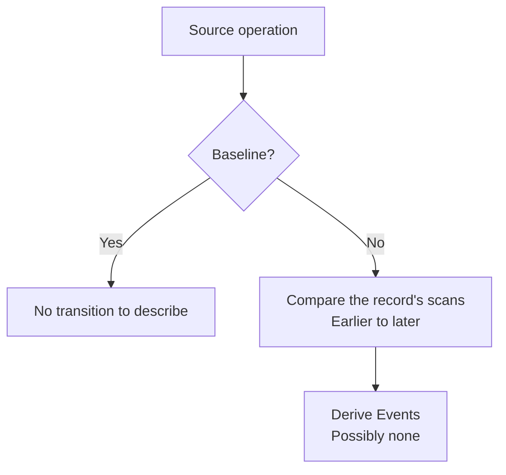

# Events

Proposed semantics using the shared operations and notation in `model.md`.

## Meaning

**Question answered:** What selected facts changed between two known scans?

| Aspect           | Meaning                                                                           |
| ---------------- | --------------------------------------------------------------------------------- |
| Input            | The record's two source scans, compared earlier → later as A → B.                 |
| Event time       | B: the scan that detects the difference.                                          |
| Identity context | Historical relationships from the relevant source scan.                           |
| Field selection  | Events choose their own fields, independently of current views and alert filters. |

Events need no baseline state. Their payloads serve ORCA's change interpretation; they are not a complete
replay log for the other tables. Raw scans retain information omitted from Events.

## Derive

| Operation | Input         | Output                                                      |
| --------- | ------------- | ----------------------------------------------------------- |
| Pair      | A → B.        | Selected differences, dated B.                              |
| Baseline  | Scan L alone. | No Events; unknown earlier history cannot establish an ADD. |

### Event types

| A → B                                    | Event  | Facts and context                  |
| ---------------------------------------- | ------ | ---------------------------------- |
| Absent → present                         | ADD    | Selected facts and context from B. |
| Present → absent                         | REMOVE | Selected facts and context from A. |
| Present → present, selected facts differ | UPDATE | Changes with context from B.       |
| Equal selected state                     | None   | No selected difference.            |

Pairs on either side of P produce the same Events; alert selection belongs to ingestion.

## Commit

| Contribution | Retain once              |
| ------------ | ------------------------ |
| Pair         | Its comparison's Events. |

Each record derives Events from its two source inputs.

## Read

| Request            | Read result                                                 |
| ------------------ | ----------------------------------------------------------- |
| One pair's Events  | Its retained Event rows.                                    |
| Feed interval      | Retained Events whose detection times fall in the interval. |
| No Events retained | Empty result.                                               |

- Select Events by detection time B; preserve A's context even when A is outside the display interval.
- The exact upstream change time remains unknown between the captures.
- Historical context must not be filled from today's current entity row.

### Product interpretation

A parent's ADD or REMOVE is its first or last listed endpoint. Whether an entity was previously known
needs earlier retained observations. Products interpret these retained facts and may apply outside knowledge about ingestion, as described in `model.md`.

## Withdraw

| Record        | Remove                            | Preserve               |
| ------------- | --------------------------------- | ---------------------- |
| Pair A → B    | Its comparison's Events, dated B. | Other records' Events. |
| Baseline at L | Nothing.                          | All Events.            |

Withdrawal removes a comparison's Events; it never reverses an ADD, REMOVE, or UPDATE.

### Interior replacement as a thought experiment

| Source states | Direct A → C        | With B known                                 |
| ------------- | ------------------- | -------------------------------------------- |
| A=1, B=2, C=1 | No selected change. | A → B changes to 2; B → C changes back to 1. |

Replace A → C with A → B and B → C. The transitions change; C's observed state remains true.
The supplied scans provide the facts needed to derive the replacement Events.
