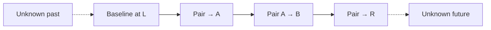
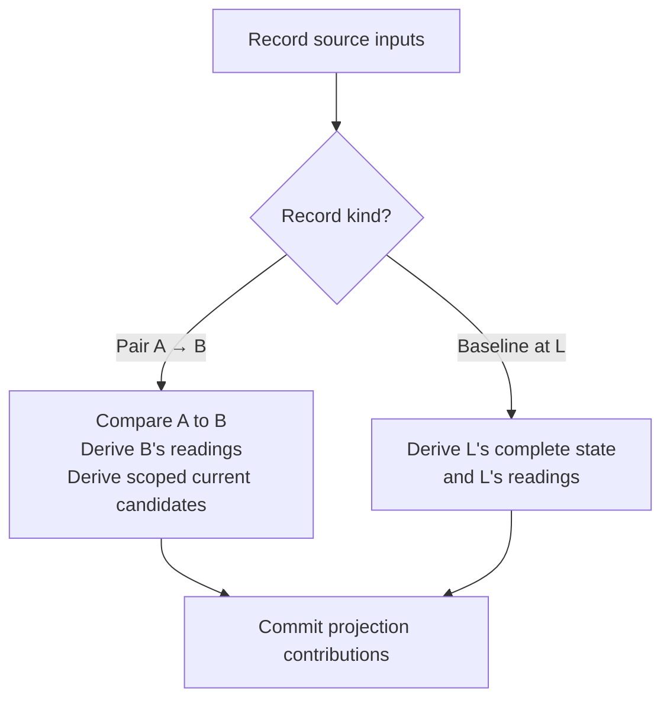
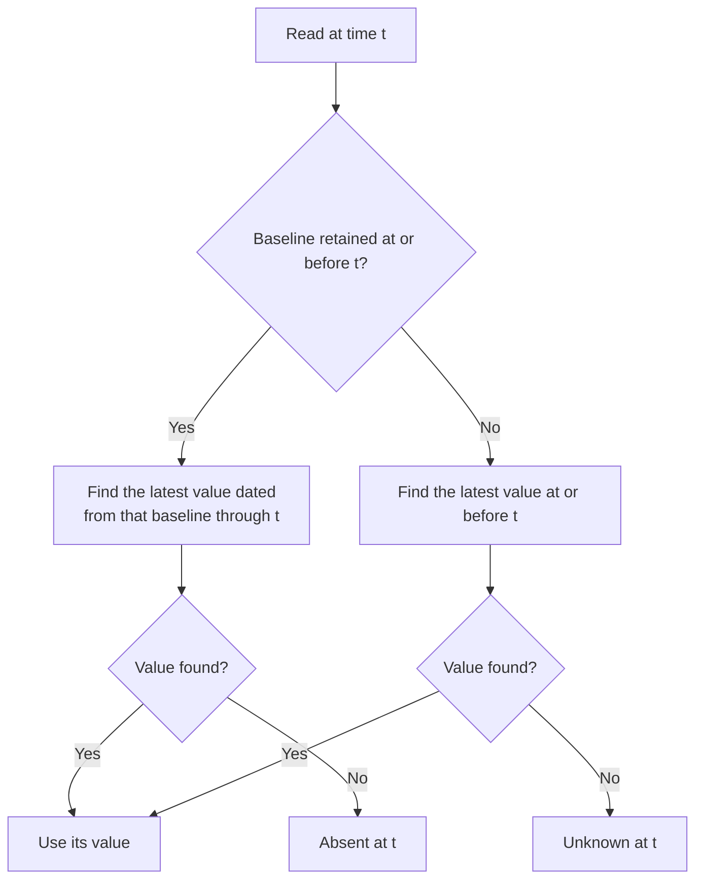
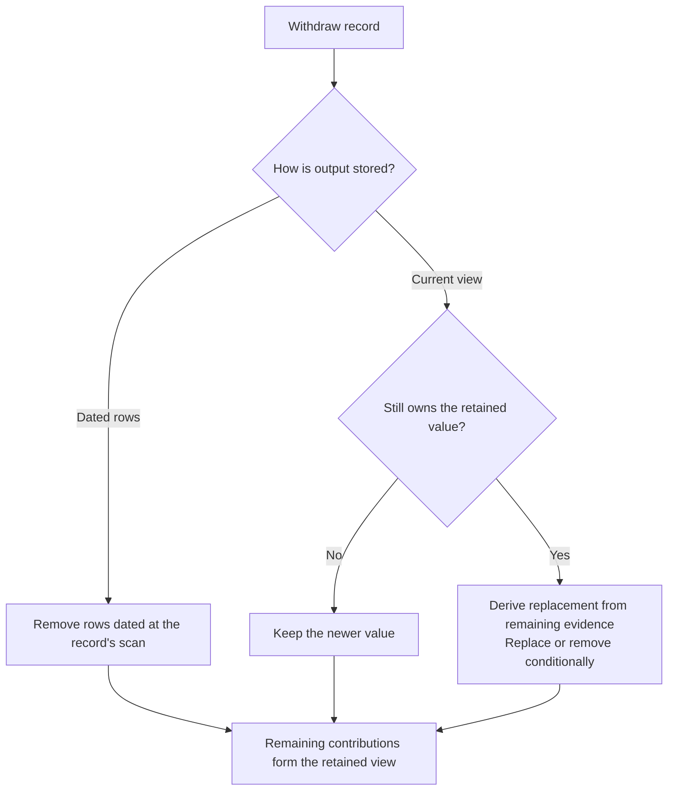
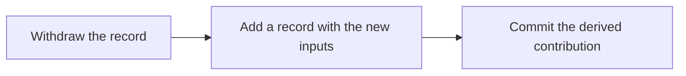

# Projection model

**Proposed model.** Records identify the scans used to build projections. Each record's source inputs
determine its contribution. Reads interpret retained data.

## Records

| Field | Meaning                                                           |
| ----- | ----------------------------------------------------------------- |
| From  | The earlier comparison scan, or null for a baseline.              |
| Scan  | The scan introduced by this record; it dates the record's output. |

| Record   | Inputs                 | Meaning                                                  |
| -------- | ---------------------- | -------------------------------------------------------- |
| Pair     | From A; scan B; A < B. | Compares A → B and introduces B.                         |
| Baseline | From null; scan L.     | Introduces the complete state at L without a comparison. |

- A baseline is the only record introducing a scan without comparing it.
- No record has a special position; record creation order carries no meaning.

### Record rules

Inequalities compare scan times.

- Pair ranges have disjoint interiors; shared endpoints are allowed. A → B and B → C share B.
- Each scan is introduced by at most one record. A → C and B → C both introduce C.
- A baseline and a pair cannot both introduce L; the baseline is withdrawn before that pair commits.
- Pairs whose scans differ from a baseline's scan are independent of it.

### Record ownership

A record owns the history output dated at its scan. The scan rule makes that ownership unambiguous.

| Record        | Owned contribution                                                           |
| ------------- | ---------------------------------------------------------------------------- |
| Pair A → B    | B's readings, the comparison A → B, and current candidates within its scope. |
| Baseline at L | L's readings, complete history state, and complete current candidates at L.  |

Current views accept a **scope** with a record's inputs. A reduced scope omits candidates that
retained output already makes redundant; each current table defines its scopes and when they suffice.

A **contribution** is the projection output owned by a record. Each table selects its content,
which may contain zero rows.

## The source window

The source window describes the times represented by retained records. L is the earliest input scan
and R the latest record scan.

| Term            | Meaning                                                                 |
| --------------- | ----------------------------------------------------------------------- |
| Scan A          | Extracted source data captured at time `t_A`.                           |
| A → B           | A pair's comparison inputs, ordered earlier → later.                    |
| Window `[L, R]` | The source window, from the earliest input scan L to the latest scan R. |
| Unknown `?`     | No source evidence. It has no contents or timestamp.                    |
| Absent `∅`      | An entity is missing from a known scan's extracted collection.          |

**Unknown is not empty.** A known scan can establish absence, a zero count, or a missing metric.
Times outside the window establish none of them.

## What each projection retains

| Projection       | Meaning                                                                       | Sufficient source inputs               |
| ---------------- | ----------------------------------------------------------------------------- | -------------------------------------- |
| Current entities | Latest selected facts for every identity seen, including unlisted identities. | A complete population and transitions. |
| Observations     | Presence, parent endpoint counts, and endpoint relationships over time.       | Baseline state and pair comparisons.   |
| Pricing history  | Complete quotes during endpoint listing periods.                              | Baseline quotes and pair comparisons.  |
| Stats history    | Readings supplied at individual times and tiers.                              | Each introduced scan.                  |
| Current stats    | One complete default-tier snapshot.                                           | One supplied scan per snapshot.        |
| Events           | Selected differences between two scans.                                       | Each individual pair.                  |

Current models, providers, and endpoints each select their own fields.
All projections derive from source scans; none depends on replaying Events.

### State, readings, and transitions

| Kind       | Example                         | What equal consecutive values mean         |
| ---------- | ------------------------------- | ------------------------------------------ |
| State      | A quote or endpoint membership. | One stored value can represent both scans. |
| Reading    | A supplied latency sample.      | Two separate readings still exist.         |
| Transition | A price UPDATE Event.           | No change to record.                       |

Sparse storage omits repeated state. Readers reconstruct the timeline from retained values.

### Reads are independent of ingestion

- Readers use retained projection rows, without querying records or ingestion state.
- A history row needs no from time; its date and value suffice.
- Missing contributions can omit changes or extend a rendered state too far; later writes refine the result.
- History reads before any baseline is retained may return nothing for unchanged entities.
- Retained data is always in progress. Readers resolve what they can and fall back to an empty result.
- Products may use outside knowledge to qualify results; projection queries do not make that decision.

## Shared operations

Each operation receives its record's source scans, any assigned scope, and any replacement evidence it needs.

| Operation | Responsibility                                                                 |
| --------- | ------------------------------------------------------------------------------ |
| Derive    | Produce content from source inputs and fixed projection rules.                 |
| Extend    | Add a pair; derive its comparison, its scan's readings, and scoped candidates. |
| Baseline  | Add a baseline; derive its scan's complete state and readings.                 |
| Commit    | Retain the derived contribution once; merge current candidates where needed.   |
| Read      | Interpret the projection rows currently retained.                              |
| Withdraw  | Remove a record and its output.                                                |

### Derive and commit have different inputs

| Stage  | May read                                              | Purpose                                               |
| ------ | ----------------------------------------------------- | ----------------------------------------------------- |
| Derive | Supplied source scans, scope, and fixed rules.        | Decide what content the sources produce.              |
| Commit | Existing rows for emitted identities or owned output. | Avoid duplicates and choose newer current candidates. |

- Each record derives its contribution from its source inputs alone.
- Repeating fixed inputs produces the same content.
- Retained contributions determine the resulting view.
- Withdrawal can need older or wider source evidence because current views discard overwritten values.

## Reading history

Observations and pricing history store state forward in time. For one entity, `q(B)` means its
selected state in scan B.

| Record                | Value                         | Meaning                             |
| --------------------- | ----------------------------- | ----------------------------------- |
| Baseline at L         | `q(L)` for every entity known | Complete state at L.                |
| Pair A → B, changed   | `q(B)` dated B                | State at and after B.               |
| Pair A → B, unchanged | No value.                     | Selected state is equal in A and B. |

- Known absence is a state. Within a baseline's scope, identities outside its population are absent at L.
- A baseline is complete: values dated before it never apply at or after it.
- A baseline retains its scan time with its values, so reads find it without consulting records.
- Every pair stores the same direction of value, whichever side of P it lies on.

| Example     | A = L | B   | C = P | D   | E   |
| ----------- | ----- | --- | ----- | --- | --- |
| Source      | 2     | 2   | 5     | 5   | 7   |
| Stored rows | 2     | —   | 5     | —   | 7   |

### Point read

At most one baseline is expected. A state the reader cannot interpret, such as several baselines,
yields an empty result. No replay of intervening scans or check of their ingestion state is needed.

### Interval read

| Step          | Action                                                                           |
| ------------- | -------------------------------------------------------------------------------- |
| Resolve start | Apply the point read at the interval start, using values dated before it.        |
| Walk forward  | Apply each value dated within the interval; a baseline replaces the whole state. |
| Display       | Clip the resulting spans to the interval.                                        |

Filtering stored rows to the display interval first would lose the state at its start.

### What a time span claims

| Time         | Interpretation                                                |
| ------------ | ------------------------------------------------------------- |
| `[t_A, t_B)` | Use A's observed state.                                       |
| At `t_B`     | Use B's observed state.                                       |
| After R      | A product may show R as last known; coverage still ends at R. |

This is a stepwise read rule. It does not claim an exact upstream change time or rule out changes
between captures. It needs neither a from time on every row nor a repeated row at every scan.

## Ownership and withdrawal

### Two meanings of time

| Concept         | Question answered             | Example                                    |
| --------------- | ----------------------------- | ------------------------------------------ |
| Record scan     | Which record owns this row?   | `q(B)` from A → B is dated and owned by B. |
| Current version | Which current candidate wins? | A candidate from A → B uses `t_B`.         |

History rows, readings, and Events are dated at their owner's scan. Current rows carry a version that
also names the owning record, but restoration can install an older version.

### Withdrawal

Withdrawal selects any record. Each table receives the source inputs and any
replacement evidence it needs.

| Record        | Owned output                                                                  |
| ------------- | ----------------------------------------------------------------------------- |
| Pair A → B    | Rows, readings, and Events dated B; current candidates versioned B.           |
| Baseline at L | Its complete history state and readings at L; current candidates versioned L. |

Deleting a current winner does not reveal the overwritten value. Raw scans supply restoration data.
For current entities, finding that data can require searching the remaining source evidence.
Withdrawal therefore cannot always be completed from a fixed number of neighbouring scans.

Withdrawal does not revisit other records' scopes. A reduced contribution that relied on withdrawn
output stays correct because restoration derives replacements from source evidence; the cost is a
longer search, not a wrong result.

### Withdraw and add

Reproducing or moving a contribution composes the same operations:

- Repair withdraws a record and adds it again with the same inputs; it is a manual operation.
- Extending behind a baseline at L withdraws it, adds the pair introducing L, then adds a new baseline.

Readers continue to interpret retained projection rows between these operations.
