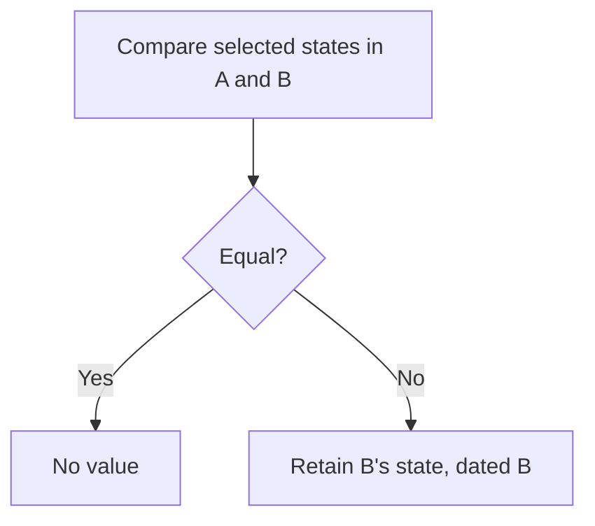
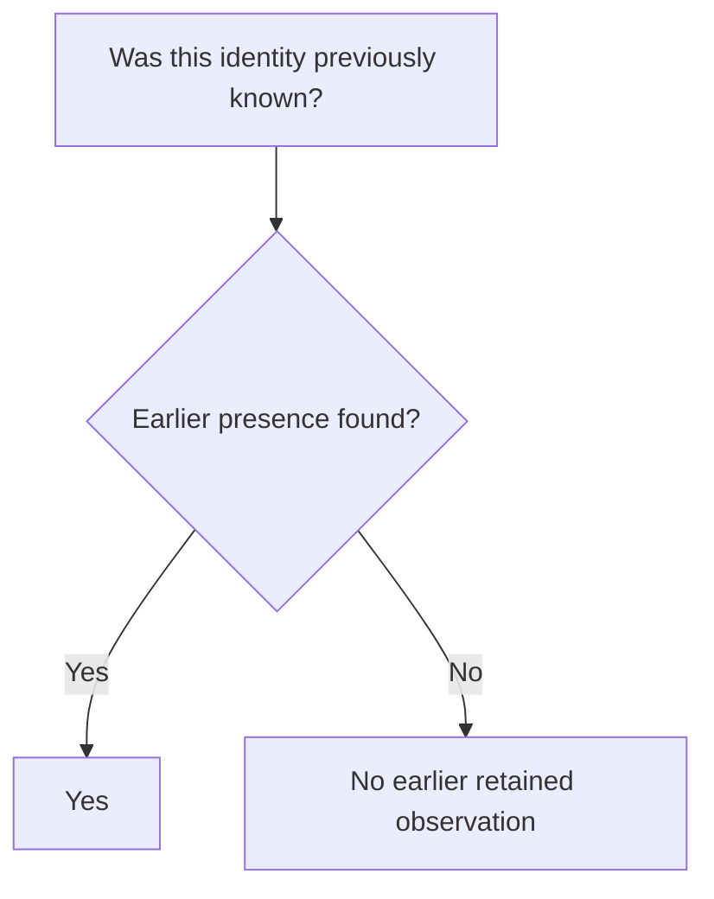

# Observations

Proposed semantics using the shared operations and notation in `model.md`.

## Meaning

**Question answered:** Which endpoints were listed, and how were they related, at a source time?

| Entity   | Selected state                                                 |
| -------- | -------------------------------------------------------------- |
| Model    | Distinct listed-endpoint count; zero means absent.             |
| Provider | Distinct listed-endpoint count; zero means absent.             |
| Endpoint | Listing state; model, provider, and provider tag while listed. |

- Counts come from the scan, not a running total of retained changes.
- Models and providers exist only through endpoints, so a parent is present exactly while it serves.
- Absent endpoints have no active membership; old relationships can remain as departure context.
- Last-known entity facts belong to current entities.

Replacing one endpoint with another can leave its parent's count unchanged.
That produces no parent observation change unless another selected field changes.

## Derive

This uses the forward history encoding from `model.md`.

| Operation | Input   | Output                                   |
| --------- | ------- | ---------------------------------------- |
| Baseline  | Scan L. | Complete selected state at L.            |
| Pair      | A → B.  | For changed entities, B's state dated B. |

### Presence changes

| Change A → B                     | Retain at B                          |
| -------------------------------- | ------------------------------------ |
| Arrival or reappearance          | Present, with current relationships. |
| Departure                        | Absent.                              |
| Relationship change while listed | New relationships.                   |

- Absence stops presence from extending through an unlisted period.
- Reappearance creates a value even when the entity returns with the same relationships.
- A baseline establishes state at L; it does not claim an arrival from the unknown past.

## Commit

| Contribution  | Retain once                                  |
| ------------- | -------------------------------------------- |
| Baseline at L | Complete state at L, with its baseline time. |
| Pair          | Its comparison's changed values.             |

Equal selected states produce no value. Readers use the retained contributions.

## Read

### State and intervals

Use the point and interval read rules in `model.md`.

| Read need              | Required context                                                                    |
| ---------------------- | ----------------------------------------------------------------------------------- |
| State at one time      | Latest value at or before the time, bounded by the latest baseline.                 |
| State over an interval | Endpoint states and internal changes; context can lie outside the display interval. |
| Membership discovery   | Baseline relationships and relationships introduced by later values.                |
| Coalesced display      | Adjacent equal states can merge visually; contribution ownership stays separate.    |

Scanning only rows dated inside the display interval misses unchanged entities and relationships.

### Prior knowledge

| Evidence                               | Meaning                                                             |
| -------------------------------------- | ------------------------------------------------------------------- |
| Present at baseline L                  | Known from L, even without a later change.                          |
| Earlier presence found during backfill | First observation moves earlier; no new discovery Event is implied. |
| Arrival dated B after L                | Observed from B; earlier absence is known back to L.                |
| Parent count 2 → 3                     | Still serving.                                                      |
| Parent count 2 → 0                     | Stops serving and departs.                                          |

Earlier backfill can change this answer. It makes no claim about history before L.

## Withdraw

| Record        | Remove                            | Preserve               |
| ------------- | --------------------------------- | ---------------------- |
| Pair A → B    | Its values dated B.               | Other records' values. |
| Baseline at L | Its complete state and time at L. | Other records' values. |

The scan rule guarantees no other record retains values dated at the withdrawn record's scan.
