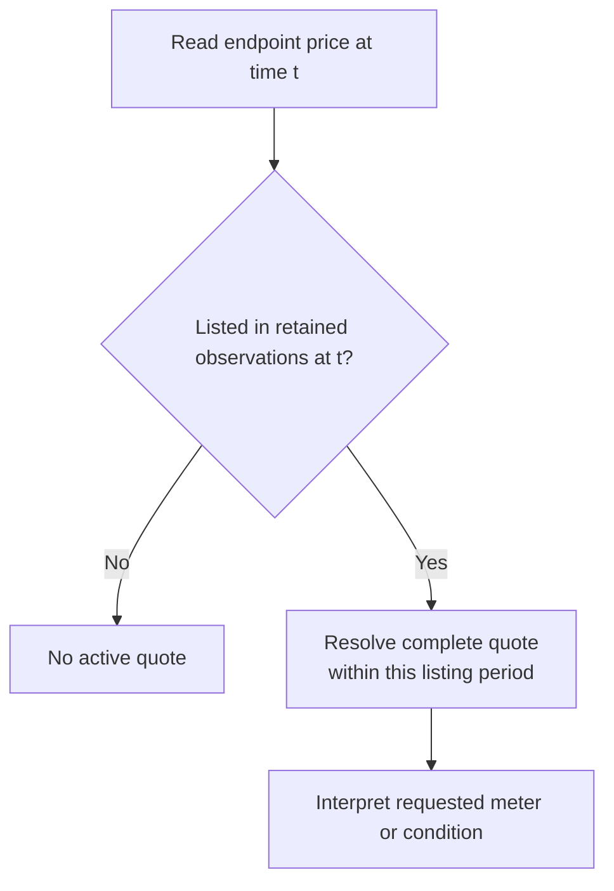

# Pricing history

Proposed semantics using the shared operations and notation in `model.md`.

## Meaning

**Question answered:** What complete quote applied to an endpoint during each listing period?

| Concept         | Meaning                                                                       |
| --------------- | ----------------------------------------------------------------------------- |
| Quote           | Complete normalized rates, discount, and conditional overrides from one scan. |
| Listing period  | A continuous period of endpoint presence established by observations.         |
| Missing meter   | The endpoint is present, but this quote has no value for that meter.          |
| No active quote | The endpoint is absent.                                                       |

A quote replaces the whole previous quote. Looking backward for an older numeric field would invent a
price where the selected quote has none. Quote selection is independent of current entity fields and Events.

## Derive

This uses the forward history encoding from `model.md`.

| Operation | Input   | Output                                                  |
| --------- | ------- | ------------------------------------------------------- |
| Baseline  | Scan L. | Complete quote for every listed endpoint at L.          |
| Pair      | A → B.  | B's quote dated B, when quote or listing state differs. |

### Quote and listing changes

| Change A → B               | Retain at B         |
| -------------------------- | ------------------- |
| Quote changes while listed | B's complete quote. |
| Arrival or reappearance    | B's complete quote. |
| Departure                  | Nothing.            |
| Listed with equal quotes   | No value.           |

- Reappearance starts a new period even when the quote repeats an earlier period's quote.
- Pricing stores no absence. Observations supply listing boundaries, so reads gate quotes on listing state.
- An arrival's pair retains the quote that opens its listing period.

## Commit

| Contribution  | Retain once                                   |
| ------------- | --------------------------------------------- |
| Baseline at L | Complete quotes at L, with its baseline time. |
| Pair          | Its comparison's changed quotes.              |

Reads combine retained quotes with listing state from observations.

## Read

### Quotes stay within their listing period

| Example      | A = L  | B      | C      |
| ------------ | ------ | ------ | ------ |
| Endpoint     | Listed | Absent | Listed |
| Quote        | $1     | —      | $1     |
| Stored quote | $1     | —      | $1     |

Reading C uses C's quote, not A's. Reading B finds no listing, so it shows no active quote.

- Search for a quote no earlier than the start of the listing period containing the read time.
- Use the point and interval rules in `model.md`, including the state at the interval start.
- Resolve quote spans and relationship spans together when filtering by model or provider.

### Boundaries a chart must preserve

| Source fact                        | Read result                                                                  |
| ---------------------------------- | ---------------------------------------------------------------------------- |
| Endpoint disappears                | End its active price span.                                                   |
| Endpoint reappears                 | Start a new span; do not bridge the absent period.                           |
| Meter becomes missing or invalid   | End that meter's usable span.                                                |
| Meter is zero                      | Keep the observed zero; a product may choose to display positive rates only. |
| Endpoint changes model or provider | Membership changes; its quote may stay equal.                                |
| Provider tag changes               | Context changes; endpoint identity still comes from its UUID.                |

Pricing conditions are interpreted by the product. A baseline quote is not a price-change Event, so row
count alone cannot measure price-change frequency.

## Withdraw

| Record        | Remove                             | Preserve               |
| ------------- | ---------------------------------- | ---------------------- |
| Pair A → B    | Its quotes dated B.                | Other records' quotes. |
| Baseline at L | Its complete quotes and time at L. | Other records' quotes. |

Retained observations supply the listing periods.
