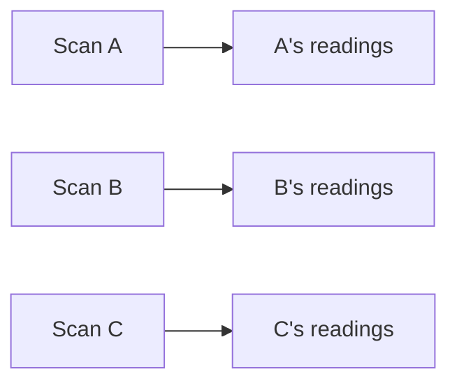
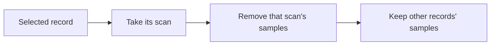

# Stats history

Proposed semantics using the shared operations and notation in `model.md`.

## Meaning

**Question answered:** Which endpoint readings were supplied at each scan time and tier?

| Source result             | Retained meaning                                     |
| ------------------------- | ---------------------------------------------------- |
| Reading supplied          | A sample at that source time and tier.               |
| Same value supplied again | Another sample.                                      |
| No reading supplied       | No sample; neither zero nor a carried-forward value. |

Stats history contains independent readings. It needs no baseline state or change comparison.

## Derive

| Operation | Input   | Output                         |
| --------- | ------- | ------------------------------ |
| Pair      | A → B.  | Every supplied reading from B. |
| Baseline  | Scan L. | Every supplied reading from L. |

Each record owns the readings of the scan it introduces. A pair's from scan supplies only comparison data.

## Commit

| Contribution     | Retain once                                      |
| ---------------- | ------------------------------------------------ |
| Pair or baseline | Its scan's samples, including repeated readings. |

## Read

| Retained data               | Read result                                            |
| --------------------------- | ------------------------------------------------------ |
| Sample present              | Return it at its own time and tier.                    |
| No sample present           | Return no reading; do not determine why it is missing. |
| Missing neighboring samples | Other retained samples remain independently readable.  |

### Repeated and missing readings

| Scan             | A   | B   | C    | D   |
| ---------------- | --- | --- | ---- | --- |
| Supplied reading | 10  | 10  | None | 12  |
| Stored sample    | 10  | 10  | —    | 12  |

C supplies no sample.

## Withdraw

| Record        | Remove       | Preserve                |
| ------------- | ------------ | ----------------------- |
| Pair A → B    | B's samples. | Other records' samples. |
| Baseline at L | L's samples. | Other records' samples. |

A scan's samples share its date with the record's history values and Events.
